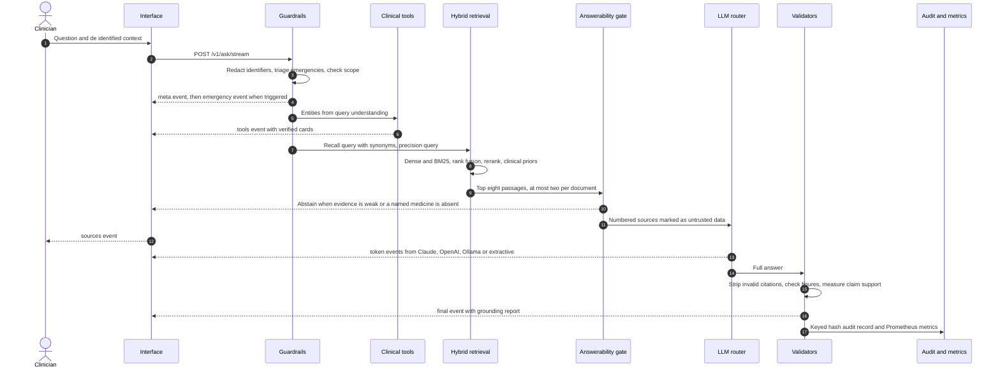

# Carina Compass AI

**Evidence grounded decision support for lung cancer treatment, built on retrieval augmented generation over real, licence tracked thoracic oncology knowledge.**

The carina is the ridge where the trachea divides into the two main bronchi, a landmark every thoracic oncologist knows from bronchoscopy and staging. Treatment in lung cancer divides in the same way, by histology, stage, driver mutation and PD L1 expression. Carina Compass AI helps the multidisciplinary team find the right branch, with every claim tied to a source they can open.

## System architecture

```mermaid
flowchart LR

    %% ═════════════ LAYER 1 · KNOWLEDGE SOURCES ═════════════
    subgraph L1["1 · KNOWLEDGE SOURCES"]
        direction TB
        NICE["<b>NICE Guidance</b><br/>NG122 · 46 TAs"]
        PDQ["<b>NCI PDQ</b><br/>Evidence summaries"]
        PUBMED["<b>PubMed</b><br/>12 query families"]
        EPMC["<b>Europe PMC</b><br/>CC BY · CC0 full text"]
        CTGOV["<b>ClinicalTrials.gov</b><br/>API v2"]
        CIVIC["<b>CIViC</b><br/>Variant evidence"]
        FDA["<b>openFDA</b><br/>Safety label sections"]
        MLP["<b>MedlinePlus</b><br/>Patient topics"]
    end

    %% ═════════════ LAYER 2 · INGESTION PIPELINE ═════════════
    subgraph L2["2 · INGESTION PIPELINE"]
        direction TB
        HARVEST["<b>Polite Harvest</b><br/>Rate limits · retries · robots.txt"]
        CHECK[("<b>Raw JSONL</b><br/>Checkpoints")]
        CLEAN["<b>Clean and Tag</b><br/>Biomarker · histology · setting"]
        DEDUP["<b>Deduplication</b><br/>64-bit SimHash"]
        CURRENCY["<b>Currency</b><br/>Supersession graph"]
        CHUNK["<b>Chunking</b><br/>Section-aware"]
        GRADE["<b>Evidence Grading</b><br/>Seven-step ladder"]
    end

    %% ═════════════ LAYER 3 · KNOWLEDGE INDEX ═════════════
    subgraph L3["3 · KNOWLEDGE INDEX"]
        direction TB
        QDRANT[("<b>Qdrant</b><br/>Dense vectors · BGE base")]
        BM25[("<b>BM25</b><br/>Clinical tokenizer")]
        MANIFEST[("<b>Build Manifest</b><br/>Counts · licences")]
    end

    %% ═════════════ LAYER 4 · QUESTION ANSWERING ═════════════
    subgraph L4["4 · QUESTION ANSWERING"]
        direction TB
        UI["<b>Clinician Interface</b><br/>React · TypeScript"]
        API["<b>FastAPI Gateway</b><br/>Keys · rate limits · SSE"]
        GUARD{{"<b>Guardrails</b><br/>Redaction · triage · scope"}}
        QU["<b>Query Understanding</b><br/>Entities · synonyms"]
        HYBRID["<b>Hybrid Retrieval</b><br/>Dense · sparse · RRF"]
        RERANK["<b>Reranker</b><br/>Clinical priors"]
        GATE{{"<b>Answerability Gate</b>"}}
        ROUTER["<b>LLM Router</b><br/>Claude · OpenAI · Ollama"]
        VALID{{"<b>Validators</b><br/>Citations · figures · claims"}}
    end

    %% ═════════════ LAYER 5 · DETERMINISTIC CLINICAL TOOLS ═════════════
    subgraph L5["5 · DETERMINISTIC CLINICAL TOOLS"]
        direction TB
        STAGE[["<b>TNM Staging</b><br/>9th edition"]]
        THERAPY[["<b>Therapy Matcher</b><br/>NICE-aligned"]]
        TRIALS[["<b>Trial Matcher</b><br/>Registry prefilter"]]
        DOSE[["<b>Dose Checks</b><br/>Calvert · BSA · CrCl"]]
        SCREEN[["<b>Safety Screen</b><br/>Medication interactions"]]
    end

    %% ═════════════ LAYER 6 · GOVERNANCE AND OPERATIONS ═════════════
    subgraph L6["6 · GOVERNANCE AND OPERATIONS"]
        direction TB
        AUDIT[("<b>Audit Log</b><br/>Keyed hash")]
        PROM["<b>Prometheus</b><br/>Metrics · alert rules"]
        GRAF["<b>Grafana</b><br/>Dashboard"]
        EVAL["<b>Evaluation Gate</b><br/>Continuous integration"]
    end

    %% ─────────── Ingestion flow ───────────
    NICE & PDQ & PUBMED & EPMC & CTGOV & CIVIC & FDA & MLP --> HARVEST
    HARVEST --> CHECK --> CLEAN --> DEDUP --> CURRENCY --> CHUNK --> GRADE
    GRADE --> QDRANT & BM25 & MANIFEST

    %% ─────────── Question flow ───────────
    UI -->|"question + context"| API --> GUARD --> QU
    GUARD -.->|"emergency banner first"| UI
    QU --> STAGE & THERAPY & TRIALS & DOSE & SCREEN
    STAGE & THERAPY & TRIALS & DOSE & SCREEN -.->|"verified tool cards"| UI
    CTGOV -.->|"registry records"| TRIALS
    QU --> HYBRID
    QDRANT & BM25 --> HYBRID
    HYBRID --> RERANK --> GATE -->|"numbered sources"| ROUTER --> VALID
    VALID -->|"cited answer stream"| UI

    %% ─────────── Governance flow ───────────
    VALID --> AUDIT & PROM
    PROM --> GRAF
    AUDIT --> EVAL

    %% ─────────── Monochrome styling: no fills, outlines only ───────────
    classDef node  fill:none,stroke:#8b949e,stroke-width:1.2px
    classDef store fill:none,stroke:#8b949e,stroke-width:1.2px
    classDef gate  fill:none,stroke:#8b949e,stroke-width:2.6px
    classDef tool  fill:none,stroke:#8b949e,stroke-width:1.2px

    class NICE,PDQ,PUBMED,EPMC,CTGOV,CIVIC,FDA,MLP,HARVEST,CLEAN,DEDUP,CURRENCY,CHUNK,GRADE,UI,API,QU,HYBRID,RERANK,ROUTER,PROM,GRAF,EVAL node
    class CHECK,QDRANT,BM25,MANIFEST,AUDIT store
    class GUARD,GATE,VALID gate
    class STAGE,THERAPY,TRIALS,DOSE,SCREEN tool

    style L1 fill:none,stroke:#8b949e,stroke-width:1px,stroke-dasharray:6 4
    style L2 fill:none,stroke:#8b949e,stroke-width:1px,stroke-dasharray:6 4
    style L3 fill:none,stroke:#8b949e,stroke-width:1px,stroke-dasharray:6 4
    style L4 fill:none,stroke:#8b949e,stroke-width:1px,stroke-dasharray:6 4
    style L5 fill:none,stroke:#8b949e,stroke-width:1px,stroke-dasharray:6 4
    style L6 fill:none,stroke:#8b949e,stroke-width:1px,stroke-dasharray:6 4
```




The architecture has six layers, numbered in the diagram in the order data and questions flow through them. Amber nodes are external sources, teal cylinders are stores, red nodes are safety gates and green nodes are deterministic tools.

**1 · Real knowledge sources.** Every document comes from a public, authoritative API: NICE guidance through the NICE Syndication API, NCI PDQ evidence summaries, PubMed abstracts across twelve thoracic oncology query families, open access full text from Europe PMC, the ClinicalTrials.gov registry, CIViC clinical interpretations of variants in cancer, openFDA structured product labels and MedlinePlus patient topics. Nothing in the knowledge base is synthetic.

**2 · Ingestion pipeline.** Connectors harvest politely, with a token bucket per host, exponential backoff that honours Retry After, and a robots.txt check before any HTML page. Raw records are checkpointed to JSONL so an interrupted harvest resumes where it stopped. Documents are cleaned without destroying clinical tokens such as ≥50%, mg/m2, L858R or HR 0.46, tagged for biomarkers (ignoring negated mentions such as "no EGFR or ALK alteration"), histology and treatment setting, collapsed with 64 bit SimHash, marked when a newer edition has replaced them, chunked inside section boundaries and graded on a seven step evidence ladder.

**3 · Knowledge index.** Qdrant holds dense vectors with payload indexes for source, jurisdiction, evidence grade, year and biomarker. A BM25 index built with a clinical tokenizer covers the exact terms dense models blur: protein changes, TNM categories, appraisal numbers and NCT identifiers. A build manifest records counts, licences and timings for provenance.

**4 · Question answering.** A question is redacted, triaged for oncology emergencies and checked for scope before anything else runs. Query understanding extracts histology, stage, TNM, biomarkers, PD L1, performance status, setting and medicines, and adds guideline synonyms (first line becomes untreated, stage IV becomes metastatic). Hybrid retrieval fuses dense and sparse results, a reranker scores them against the question, and clinical priors decide what reaches the model. An answerability gate abstains when the evidence is weak or a named medicine is missing. The model writes the answer from numbered sources, and every sentence, figure and claim is checked against them before it reaches the clinician.

**5 · Deterministic clinical tools.** Staging, NICE aligned treatment options, trial prefiltering, carboplatin and body surface area checks and the medication safety screen are computed from reviewed rules and formulae. Their results stream as separate cards and are never placed in the model prompt, which keeps the figure check honest.

**6 · Governance and operations.** Every answer is audited without storing patient text, measured in Prometheus with alert rules for safety signals, shown on a provisioned Grafana dashboard, and the evaluation suite runs as a gate in continuous integration.

The diagram source is kept at `docs/architecture.mmd` for slides and design reviews.

## Interactive demo

`demo/carina_compass_demo.html` is a single page that runs entirely in the browser on the verified seed snapshot. Open it directly from the repository; no server, key or network access is needed.

The page performs real BM25 retrieval over the chunked seed knowledge base with the same clinical priors as the service, applies the same redaction and emergency triage rules, stages TNM combinations with the 9th edition tables, matches NICE aligned treatment options from the same rule file the API uses, and composes an extractive answer in which every sentence carries a numbered citation and every clinical figure is checked against its source.

Try these to see each layer at work:

* *First line options for stage IVA lung adenocarcinoma with EGFR exon 19 deletion, PS 1?* shows the therapy matcher ranking osimertinib (TA654) first, and adjuvant evidence held back because the setting does not match.
* *Mr John Smith, NHS number 943 476 5919, KRAS G12C NSCLC progressed after chemo immunotherapy: options and trials?* shows the name and a valid NHS number redacted, sotorasib through the Cancer Drugs Fund, and KRAS G12C registry records.
* *Patient on carboplatin and pemetrexed, day 10, temperature 38.6 and rigors* shows the neutropenic sepsis banner appearing before anything else.

The deployed service writes the answer with Claude (or OpenAI, or a local Ollama model) under exactly the same citation and figure checks. Rebuild the demo from the current seed and rule files with `make demo_build`.

## Project brief

A lung cancer multidisciplinary team in the United Kingdom makes treatment decisions that depend on a body of guidance no individual can hold in their head. NICE NG122 sets out the pathway, but systemic treatment now runs through more than sixty NICE technology appraisals that differ by histology, stage, driver mutation, PD L1 threshold, line of therapy and funding route, and several of them have been replaced, terminated or moved in and out of the Cancer Drugs Fund. Molecular profiling now reports EGFR, ALK, ROS1, KRAS G12C, BRAF, MET, RET, NTRK and HER2 status for most patients with advanced non small cell lung cancer, and the 9th edition of the TNM classification has changed several stage groups that decide between surgery, chemoradiotherapy and systemic treatment.

General purpose chatbots are a poor fit for this work. They answer fluently from training data of unknown date, they mix adjuvant and metastatic evidence, they quote trial figures that are close but not exact, and they cannot say which NICE appraisal governs NHS access. In oncology an unverifiable answer is not a time saving. A wrong carboplatin dose, a targeted therapy offered in the wrong line, or a recommendation drawn from a withdrawn appraisal can harm a patient, and the clinician remains professionally accountable for every decision.

Carina Compass AI is designed around that accountability. It answers only from a licence tracked knowledge base of real UK guidance, international evidence summaries, peer reviewed trials and registry records. It ties every factual sentence to a numbered source, ranks UK national guidance above trials and trials above registries, keeps adjuvant evidence out of metastatic answers and one driver's evidence out of another's, labels superseded guidance, refuses to answer when the evidence is too thin, and moves every safety critical number out of the language model into deterministic, version controlled tools. Emergencies such as neutropenic sepsis or spinal cord compression are recognised before any search begins.

The result is a tool a lung cancer MDT can question in plain clinical language and then audit, because every claim, every figure and every rule can be traced to its source and its review date.

## What Carina Compass AI does

* **Cited answers for the MDT.** Questions about staging, surgery, radiotherapy, perioperative and adjuvant treatment, metastatic systemic therapy, small cell lung cancer, evidence and toxicity are answered in British English with an inline citation on every factual sentence.
* **NICE aligned treatment options.** A deterministic matcher reads the de identified patient context and returns the options NICE has appraised for that histology, stage, setting, biomarker, PD L1 level, performance status and prior treatment, each with its appraisal number, status (recommended, Cancer Drugs Fund, not recommended, terminated, or check the appraisal), pivotal trial and any missing information.
* **TNM 9th edition staging.** Stage groups from T, N and M categories or free text such as cT2a N2b M0, the 8th edition group alongside, the T category from tumour size and invasion, and a plain note when an assumption was made.
* **Trial matching.** ClinicalTrials.gov records are prefiltered by recruitment status, biomarker, histology, setting, age limits, sex and UK sites, with every caution stated.
* **Dose checks.** Carboplatin by the Calvert formula with the GFR cap most UK protocols apply, creatinine clearance by Cockcroft and Gault, body surface area by Mosteller or DuBois, and ECOG to Karnofsky mapping, each showing its working and warnings.
* **Medication safety screen.** Planned treatment is checked against current medicines, conditions, allergies and renal function: CYP3A inducers with lorlatinib and other kinase inhibitors, acid suppression with erlotinib, gefitinib and sotorasib, QT prolongation, interstitial lung disease, autoimmune disease and transplants with checkpoint inhibitors, pemetrexed and cisplatin renal thresholds and more, each linked to the SmPC section.
* **Emergency first triage.** Suspected neutropenic sepsis, metastatic spinal cord compression, superior vena cava obstruction, airway obstruction or major haemoptysis, hypercalcaemia, severe immune related toxicity, raised intracranial pressure and anaphylaxis trigger an action banner streamed before retrieval.
* **Guideline currency.** A supersession graph recognises replaced guidance (CG121 by NG122, TA761 by TA1043, TA416 by TA653, TA447 by TA531, TNM 8 by TNM 9), demotes it in ranking and labels it in the answer and the interface.
* **Patient data protection.** Names with titles, valid NHS numbers, hospital numbers, postcodes, dates of birth, addresses, phone numbers and email addresses are redacted before any text reaches retrieval, a model vendor, the cache or a log.
* **Model choice.** Claude through the Anthropic API is the default; OpenAI and a fully local Ollama model can be selected per deployment or per request, and an extractive generator answers when no model is reachable.
* **Clinical governance.** Clinicians rate answers with reasons, comments are redacted before storage, and an admin summary reports abstention, grounding, claim support, emergencies, tool use, superseded sources cited and negative feedback.

## The knowledge base

<table>
<thead>
<tr><th>Source</th><th>What is ingested</th><th>Access</th><th>Licence handling</th><th>Role in answers</th></tr>
</thead>
<tbody>
<tr><td>NICE</td><td>NG122 lung cancer, NG12 suspected cancer, CG151 neutropenic sepsis, NG234 spinal metastases and 36 lung cancer technology appraisals</td><td>NICE Syndication API</td><td>Syndication licence key required</td><td>Highest priority UK guidance</td></tr>
<tr><td>NCI PDQ</td><td>Non small cell, small cell and mesothelioma treatment summaries for health professionals</td><td>Polite HTML harvest honouring robots.txt</td><td>US government work, public domain</td><td>International evidence summary</td></tr>
<tr><td>PubMed</td><td>Abstracts across twelve query families: EGFR; ALK and ROS1; KRAS, BRAF, MET, RET, NTRK and HER2; advanced immunotherapy; perioperative treatment; surgery; radiotherapy; stage III; small cell; staging and diagnosis; toxicity and supportive care; mesothelioma</td><td>NCBI Entrez with history server batching, systematic reviews and trials first</td><td>Abstracts indexed under fair dealing</td><td>Research evidence graded by publication type</td></tr>
<tr><td>Europe PMC</td><td>Open access full text on lung cancer treatment</td><td>REST API with cursor paging</td><td>Only CC BY and CC0 records retained</td><td>Research evidence with full sections</td></tr>
<tr><td>ClinicalTrials.gov</td><td>Every registered study for non small cell, small cell, lung and pleural mesothelioma</td><td>API version 2 with page tokens</td><td>US public registry</td><td>Trial matching and registry context</td></tr>
<tr><td>CIViC</td><td>Accepted predictive, prognostic and diagnostic variant evidence in lung cancers</td><td>Nightly evidence TSV</td><td>CC0</td><td>Biomarker evidence graded by CIViC level</td></tr>
<tr><td>openFDA</td><td>Safety and pharmacology sections of labels for 45 thoracic oncology medicines</td><td>openFDA drug label API</td><td>US public domain</td><td>Warnings and interactions, never doses</td></tr>
<tr><td>MedlinePlus</td><td>Plain language lung cancer and mesothelioma topics</td><td>NLM web service</td><td>US public domain</td><td>Patient conversations, lowest rank</td></tr>
</tbody>
</table>

The PubMed query families alone return well over a hundred thousand records, and ClinicalTrials.gov holds several thousand lung cancer studies, which is why the pipeline streams to disk, deduplicates by fingerprint and indexes in batches rather than holding the corpus in memory. Systematic reviews, meta analyses, randomised and phase 3 trials and practice guidelines are harvested in a priority pass, so a capped run still indexes the strongest evidence first. Dosage sections of US labels are deliberately never indexed, so a US dose can never be retrieved as UK guidance.

A **verified seed snapshot** of 86 records ships with the repository so the service starts, the tests run and the demo works before the full harvest. It is a slice of the real knowledge base, not invented content: NG122 recommendations by section checked against the guideline PDF, 46 NICE technology appraisals with titles and dates from the NICE lung cancer listing, eight pivotal trials (FLAURA, ADAURA, KEYNOTE 024, KEYNOTE 189, CheckMate 816, IMpower010, ALINA and CodeBreaK 100) with PMIDs confirmed against PubMed, fifteen ClinicalTrials.gov records with confirmed NCT numbers, the 8th and 9th edition TNM stage groups, and the neutropenic sepsis and spinal cord compression guidance. Every record is a summary in our own words, links to its authoritative source and says how it was verified. Where a recommendation status could not be confirmed, the record says to check the appraisal rather than guessing. Full provenance is in `docs/data_sources.md`.

Evidence is graded on a seven step ladder used for both ranking and display:

<table>
<thead>
<tr><th>Grade</th><th>Meaning</th><th>Typical source</th></tr>
</thead>
<tbody>
<tr><td>7</td><td>UK national guidance</td><td>NICE guidelines and technology appraisals</td></tr>
<tr><td>6</td><td>International guidance or evidence summary</td><td>NCI PDQ, international practice guidelines</td></tr>
<tr><td>5</td><td>Systematic review or meta analysis</td><td>Cochrane reviews, CIViC level A</td></tr>
<tr><td>4</td><td>Randomised controlled trial</td><td>FLAURA, KEYNOTE 189, CIViC level B</td></tr>
<tr><td>3</td><td>Observational, early phase or regulatory</td><td>Phase 1 and 2 studies, drug labels, staging validation cohorts</td></tr>
<tr><td>2</td><td>Case report or series</td><td>Case reports, CIViC level C</td></tr>
<tr><td>1</td><td>Expert opinion, narrative review or registry entry</td><td>Narrative reviews, trial registrations, patient information</td></tr>
</tbody>
</table>

## How a question is answered



1. **Redaction.** Identifiers are replaced with typed placeholders such as [NHS_NUMBER] and [NAME]. NHS numbers are only redacted when they pass the modulus 11 check, so a ten digit laboratory value survives. Nothing identifiable leaves the request.
2. **Emergency triage.** Pattern rules for eight oncology emergencies run first. A match streams an action banner immediately, is never served from cache, and adds the matching guidance to the retrieval query.
3. **Scope check.** Questions with no thoracic oncology content are declined without spending a model call. A question that names a trial or appraisal in the index, or arrives with patient context or in an in scope conversation, is accepted.
4. **Query understanding and tools.** Brand names map to generics (Tagrisso to osimertinib, Keytruda to pembrolizumab), US spellings map to UK spellings, and histology, stage, TNM, biomarkers, PD L1, performance status, setting and medicines are extracted. The deterministic tools the question calls for run now and stream as cards.
5. **Hybrid retrieval.** A recall query (the question plus guideline synonyms) searches Qdrant (top 40) and BM25 (top 40); results are fused by reciprocal rank fusion and the head is reranked against a precision query (the question itself), with synonyms earning partial credit. Clinical concept tokens let "exon 19 deletion" and "EGFR mutation positive" meet, and "stage IVA" and "metastatic" meet.
6. **Clinical priors.** The reranker score is multiplied by a boost built from evidence grade, recency with a six year half life for research, a UK jurisdiction bonus, a match or conflict for biomarker, treatment setting and histology, and a halving for superseded guidance. Priors scale relevance rather than add to it, so provenance alone never lifts an irrelevant passage. No document may fill more than two of the eight context slots.
7. **Injection filter and answerability.** Retrieved passages that try to instruct the model are dropped. The system abstains when the best evidence is below the threshold, when the question's most specific terms (weighted by inverse document frequency, with synonyms credited) are missing from the top passages, or when a named medicine or biomarker appears in none of them. Emergencies keep their banner even when the answer abstains.
8. **Generation.** Sources are passed as numbered XML blocks carrying title, source type, evidence grade, year, jurisdiction and a superseded flag, followed by currency notes and the de identified context. The system prompt, cached at the provider, requires a citation on every factual sentence, forbids any figure not present in a cited source, separates trial evidence from NHS recommendation and requires a closing clinical judgement line. The router tries the selected model, then the configured fallbacks, then the extractive generator, with a circuit breaker per vendor.
9. **Validation.** Citations to ids that were never supplied are removed and sentence coverage is measured. Every number carrying a clinical unit (percentages, months, mg, mg/m2, Gy, fractions, cycles, hazard ratios) must match a number in a cited source, compared numerically so 0.5 matches 0.50; anything unmatched is flagged inside the answer. Each cited sentence is then compared with its passages, weighting medicines, biomarkers and numbers, and the share of supported claims is reported. An answer is grounded only when coverage, figures and claim support all pass.
10. **Audit.** A record with a keyed hash of the redacted question, the sources used, coverage, figures, claim support, provider, fallbacks and latency is appended to the audit log.

## Clinical safety design

<table>
<thead>
<tr><th>Risk</th><th>Control</th><th>Where it lives</th></tr>
</thead>
<tbody>
<tr><td>Invented or wrong dose</td><td>Doses come only from deterministic formulae with plausibility limits; generated figures must match a cited source; US label dosage sections are never indexed</td><td><code>backend/carina/clinical/dosing.py</code>, <code>backend/carina/generation/citations.py</code></td></tr>
<tr><td>Treatment presented as NHS funded when it is not</td><td>Therapy matrix names the governing appraisal and its status, with check the appraisal where status was not confirmed</td><td><code>backend/carina/knowledge/therapy_matrix.yaml</code></td></tr>
<tr><td>Adjuvant evidence applied to metastatic disease</td><td>Chunk level setting tags with match boosts and conflict penalties, sentence level setting filter, setting aware therapy matcher</td><td><code>backend/carina/retrieval/hybrid.py</code>, <code>ingestion/processing/chunker.py</code></td></tr>
<tr><td>One driver's evidence applied to another</td><td>Negation aware biomarker tags, biomarker conflict penalty, targeted therapy before immunotherapy for driver positive disease</td><td><code>backend/carina/clinical/understanding.py</code>, <code>backend/carina/clinical/therapy.py</code></td></tr>
<tr><td>Withdrawn guidance presented as current</td><td>Supersession graph halves the score, labels the source and the sentence, and instructs the model</td><td><code>backend/carina/knowledge/supersession.yaml</code></td></tr>
<tr><td>Delay in an oncology emergency</td><td>Triage before retrieval, banner as the first streamed event, never cached, never blocked by the evidence gate</td><td><code>backend/carina/guardrails/emergency.py</code></td></tr>
<tr><td>Unverifiable claim</td><td>Mandatory inline citations, invalid ids stripped, coverage and claim support measured and shown</td><td><code>backend/carina/generation</code></td></tr>
<tr><td>Answering beyond the evidence</td><td>Answerability gate on evidence strength, query coverage and named medicines; explicit abstention</td><td><code>backend/carina/generation/answerability.py</code></td></tr>
<tr><td>Prescribing into an interaction or contraindication</td><td>Medication safety screen with SmPC referenced rules and renal thresholds</td><td><code>backend/carina/clinical/safety_screen.py</code></td></tr>
<tr><td>Patient data leaving the organisation</td><td>Redaction before retrieval, model calls, cache and logs; keyed hash audit; Ollama for on site inference</td><td><code>backend/carina/guardrails/pii.py</code>, <code>backend/carina/audit.py</code></td></tr>
<tr><td>Prompt injection through a harvested document</td><td>Instruction like passages dropped; sources marked as untrusted data</td><td><code>backend/carina/guardrails/injection.py</code></td></tr>
<tr><td>Referral to a closed trial</td><td>Status verified flag, cautions on every unverified record, refresh with <code>make ingest_trials</code></td><td><code>backend/carina/clinical/trials.py</code></td></tr>
<tr><td>Model vendor outage during an MDT</td><td>Ordered fallback chain with circuit breakers ending in the extractive generator</td><td><code>backend/carina/llm/router.py</code></td></tr>
</tbody>
</table>

Carina Compass AI is decision support for registered healthcare professionals. It does not diagnose individual patients, it is not a medical device, and it does not replace NICE guidance, the SmPC, the BNF, local SACT protocols or the judgement of the lung cancer MDT. A deployment used in patient care should complete the DCB0129 safety case drafted in `docs/clinical_safety_case.md`, a DCB0160 assessment and a data protection impact assessment.

## Evaluation

`evaluation/golden_set.jsonl` holds 48 real clinical questions: targeted therapy for every actionable driver, immunotherapy by PD L1 level and histology, perioperative and adjuvant treatment, stage III consolidation, surgery and radiotherapy, small cell lung cancer, staging, guideline currency, dose and interaction checks, four oncology emergencies, unanswerable and out of scope questions, and a redaction test. Each question names the sources that should be retrieved, the facts the answer should contain, the tools that should fire, the emergency expected and the expected status.

Offline baseline, measured on the seed snapshot with the hashing embedder, the lexical reranker and the extractive generator, which is the configuration continuous integration runs without network access. Thresholds live in `evaluation/thresholds.yaml` and `make eval_gate` fails the build when any is missed.

<table>
<thead>
<tr><th>Metric</th><th>Offline baseline</th><th>CI gate</th></tr>
</thead>
<tbody>
<tr><td>Questions</td><td>48</td><td></td></tr>
<tr><td>Retrieval hit at 5</td><td>1.000</td><td>at least 0.90</td></tr>
<tr><td>Retrieval mean reciprocal rank</td><td>0.934</td><td>at least 0.80</td></tr>
<tr><td>Expected fact recall</td><td>0.987</td><td>at least 0.85</td></tr>
<tr><td>Citation coverage</td><td>1.000</td><td>at least 0.90</td></tr>
<tr><td>Claim support</td><td>1.000</td><td>at least 0.90</td></tr>
<tr><td>Answers with an unsupported figure</td><td>0.000</td><td>must be 0</td></tr>
<tr><td>Answered when an answer was expected</td><td>1.000</td><td>at least 0.90</td></tr>
<tr><td>Emergency triage accuracy</td><td>1.000</td><td>must be 1.0</td></tr>
<tr><td>Abstention accuracy</td><td>1.000</td><td>at least 0.90</td></tr>
<tr><td>Scope accuracy</td><td>1.000</td><td>must be 1.0</td></tr>
<tr><td>Tool routing accuracy</td><td>1.000</td><td>at least 0.95</td></tr>
<tr><td>Redaction accuracy</td><td>1.000</td><td>must be 1.0</td></tr>
</tbody>
</table>

Because the extractive generator copies sentences verbatim, citation coverage and claim support are perfect by construction offline; the retrieval, fact recall, abstention, triage, routing and redaction figures are the informative ones. `make eval_live` runs the same suite against the live index and the configured model, where coverage, figure checks and claim support measure the model itself, and writes a JSON and Markdown report to `evaluation/reports`. The test suite adds 172 unit, pipeline and API tests, including the full 9th edition stage table.

## Repository layout

```
Carina Compass AI
├── backend/carina
│   ├── api/                 routes, schemas, API keys and rate limiting
│   ├── clinical/            staging, therapy matcher, trials, dosing, safety screen, query understanding, tool router
│   ├── knowledge/           reviewed rule files: lexicon, therapy matrix, safety rules, emergencies, supersession
│   ├── guardrails/          redaction, emergency triage, scope and injection filters
│   ├── retrieval/           clinical tokenizer, BM25, embedders, vector stores, reranker, hybrid retriever, index
│   ├── generation/          prompts, pipeline, citations, faithfulness, answerability, extractive generator
│   ├── llm/                 Anthropic, OpenAI and Ollama providers, router with circuit breakers
│   ├── observability/       Prometheus metrics
│   ├── audit.py             keyed hash audit log, feedback and governance summary
│   ├── cache.py             memory or Redis answer cache
│   ├── cli.py               ask, understand, stage, options, screen, carboplatin and serve
│   ├── config.py            typed settings
│   ├── container.py         service wiring
│   ├── domain.py            documents, chunks, evidence grades, licences, patient context
│   └── main.py              FastAPI application
├── ingestion
│   ├── config/corpus.yaml   query families, conditions, drugs, appraisals and pages to harvest
│   ├── sources/             NICE, NCI PDQ, PubMed, Europe PMC, ClinicalTrials.gov, CIViC, openFDA, MedlinePlus
│   ├── processing/          cleaner, clinical tagger, evidence grader, SimHash deduplication, chunker
│   ├── data/seed/           verified seed snapshot
│   ├── pipeline.py          harvest, checkpoint, deduplicate, currency, chunk, embed, index
│   └── cli.py               seed, run, build and stats
├── evaluation/              golden set, metrics, harness, thresholds and reports
├── frontend/                React and TypeScript clinician interface with nginx image
├── demo/                    standalone browser demo and its template
├── docs/                    architecture source, clinical safety case, data sources, model card, decision records
├── deploy/                  Prometheus scrape and alert rules, Grafana provisioning and dashboard
├── scripts/                 demo builder and README style check
├── tests/                   unit and integration tests
├── .github/                 CI workflow, dependabot, issue and pull request templates
├── Dockerfile               API image
├── compose.yaml             API, Qdrant, Redis, interface, Prometheus, Grafana and optional Ollama
└── Makefile                 every common task
```

## Getting started

Requirements are Python 3.11 or newer, Node 22 for the interface and Docker for the full stack.

```bash
cp .env.example .env          # add ANTHROPIC_API_KEY for generated answers
make install                  # Python and interface dependencies
make seed                     # index the verified seed snapshot in seconds
make serve                    # API on port 8000
make frontend                 # interface on port 5173
```

To build the full knowledge base and run the complete stack:

```bash
make install_ml               # BGE embeddings, cross encoder, Qdrant and Redis clients
make up                       # API, Qdrant, Redis, interface, Prometheus and Grafana
make ingest                   # harvest every source and build the index (several hours)
make ingest_quick             # capped harvest for development
make ingest_trials            # refresh ClinicalTrials.gov records only
make check                    # lint, types, tests, evaluation gate and README style
```

From the terminal, against the seed snapshot with no index or key:

```bash
carina ask "Is adjuvant osimertinib recommended after resection of stage IIIA L858R NSCLC?"
carina stage cT2a N2b M0
carina options adenocarcinoma IVA ALK
carina screen lorlatinib with rifampicin
carina carboplatin 5 68 72 96 male
```

The container stack serves the interface on port 8080, the API on 8000, Prometheus on 9090 and a provisioned Grafana dashboard on 3000. `make up_local` adds an Ollama container so every query stays inside the network. Without any API key the service still runs end to end with the extractive generator.

## Configuration

All settings are environment variables with the `CC_` prefix, read by `backend/carina/config.py` and listed in `.env.example`. List settings take comma separated values.

<table>
<thead>
<tr><th>Variable</th><th>Default</th><th>Purpose</th></tr>
</thead>
<tbody>
<tr><td><code>CC_LLM_PROVIDER</code></td><td>anthropic</td><td>anthropic, openai, ollama or extractive</td></tr>
<tr><td><code>CC_LLM_FALLBACKS</code></td><td>openai, extractive</td><td>providers tried in order when the primary fails</td></tr>
<tr><td><code>CC_ANTHROPIC_MODEL</code></td><td>Claude Sonnet 5.5</td><td>Claude model used for generation</td></tr>
<tr><td><code>CC_OLLAMA_MODEL</code></td><td>Llama 3.1 8B</td><td>local model for on premises deployments</td></tr>
<tr><td><code>CC_EMBEDDING_BACKEND</code></td><td>hashing</td><td>hashing offline, sentence_transformers for BGE base</td></tr>
<tr><td><code>CC_RERANKER_BACKEND</code></td><td>lexical</td><td>lexical offline, cross_encoder for BGE reranker base</td></tr>
<tr><td><code>CC_VECTOR_BACKEND</code></td><td>memory</td><td>memory or qdrant</td></tr>
<tr><td><code>CC_TOP_K_FINAL</code></td><td>8</td><td>passages passed to the model</td></tr>
<tr><td><code>CC_EVIDENCE_WEIGHT</code></td><td>0.30</td><td>weight of the evidence grade in the ranking boost</td></tr>
<tr><td><code>CC_SETTING_BONUS</code></td><td>0.40</td><td>boost for a matching treatment setting and penalty for a conflicting one</td></tr>
<tr><td><code>CC_BIOMARKER_BONUS</code></td><td>0.20</td><td>boost for a matching driver and penalty for a different driver</td></tr>
<tr><td><code>CC_RECENCY_HALF_LIFE_YEARS</code></td><td>6</td><td>recency decay for research evidence</td></tr>
<tr><td><code>CC_MIN_EVIDENCE_SCORE</code></td><td>0.30</td><td>below this the system abstains</td></tr>
<tr><td><code>CC_MIN_QUERY_COVERAGE</code></td><td>0.40</td><td>share of the question's specific terms the evidence must cover</td></tr>
<tr><td><code>CC_MIN_FAITHFULNESS</code></td><td>0.5</td><td>claim support needed for an answer to count as grounded</td></tr>
<tr><td><code>CC_API_KEYS</code></td><td>empty</td><td>keys for the assistant and tool endpoints; empty means open in development</td></tr>
<tr><td><code>CC_ADMIN_API_KEYS</code></td><td>empty</td><td>keys allowed to read the governance summary</td></tr>
<tr><td><code>CC_AUDIT_SALT</code></td><td>local value</td><td>secret for keyed question hashes; set a long random value in production</td></tr>
<tr><td><code>NCBI_API_KEY</code></td><td>empty</td><td>raises PubMed throughput from 3 to 10 requests per second</td></tr>
<tr><td><code>NICE_SYNDICATION_API_KEY</code></td><td>empty</td><td>enables the NICE connector under the syndication licence</td></tr>
</tbody>
</table>

## API reference

<table>
<thead>
<tr><th>Method</th><th>Path</th><th>Purpose</th></tr>
</thead>
<tbody>
<tr><td>POST</td><td><code>/v1/ask</code></td><td>Complete cited answer with sources, tool cards, grounding report and safety flags</td></tr>
<tr><td>POST</td><td><code>/v1/ask/stream</code></td><td>Server sent events: meta, emergency, tools, sources, token, final</td></tr>
<tr><td>POST</td><td><code>/v1/understand</code></td><td>Entities, triage and tool cards for a question, without retrieval</td></tr>
<tr><td>POST</td><td><code>/v1/search</code></td><td>Hybrid evidence search with source, evidence grade and jurisdiction filters</td></tr>
<tr><td>POST</td><td><code>/v1/tools/stage</code></td><td>TNM stage group from categories, free text or tumour size</td></tr>
<tr><td>POST</td><td><code>/v1/tools/therapy</code></td><td>NICE aligned treatment options for a patient context</td></tr>
<tr><td>POST</td><td><code>/v1/tools/trials</code></td><td>Registry prefilter of trials for a patient context</td></tr>
<tr><td>POST</td><td><code>/v1/tools/carboplatin</code></td><td>Calvert dose check from a GFR or from age, weight, creatinine and sex</td></tr>
<tr><td>POST</td><td><code>/v1/tools/bsa</code></td><td>Body surface area by Mosteller or DuBois</td></tr>
<tr><td>POST</td><td><code>/v1/tools/screen</code></td><td>Medication safety screen against medicines, conditions, allergies and renal function</td></tr>
<tr><td>GET</td><td><code>/v1/tools/performance</code></td><td>ECOG and Karnofsky correspondence</td></tr>
<tr><td>POST</td><td><code>/v1/feedback</code></td><td>Clinician rating of an answer by request id, with reasons</td></tr>
<tr><td>GET</td><td><code>/v1/knowledge</code></td><td>Index manifest and the version and review date of every rule file</td></tr>
<tr><td>GET</td><td><code>/v1/audit/summary</code></td><td>Governance figures from the audit and feedback logs (admin key)</td></tr>
<tr><td>GET</td><td><code>/health</code></td><td>Index size, provider chain with circuit states and cache backend</td></tr>
<tr><td>GET</td><td><code>/ready</code></td><td>Readiness: the index is loaded and can answer</td></tr>
<tr><td>GET</td><td><code>/metrics</code></td><td>Prometheus metrics</td></tr>
</tbody>
</table>

Once keys are configured, requests carry the API key header. Interactive OpenAPI documentation is served at <code>/docs</code> when the API is running.

## Switching language models

The pipeline talks to a provider neutral interface, so changing vendor is a configuration change. Set `CC_LLM_PROVIDER` for the deployment default or pass `provider` in a request to compare answers side by side. Claude receives the system prompt as a cached block, which lowers cost and latency for repeat consultations. Ollama keeps every query inside the organisation, which suits trusts whose information governance does not allow clinical text to leave site. Retrieval, tools, guardrails and validation are identical whichever model is selected, and the extractive generator always closes the chain.

## Licensing and data governance

The code is released under the Apache 2.0 licence. Content in the knowledge base keeps its original licence, recorded on every document and chunk and summarised in the build manifest. NICE content requires a NICE syndication licence for storage and redistribution; without one the index carries NICE recommendations only as summaries in our own words with links to the source. Europe PMC content is restricted to CC BY and CC0 records. PubMed abstracts are indexed for retrieval and short quotation with a link to the source. NCI PDQ, ClinicalTrials.gov, openFDA and MedlinePlus content are US government works, and CIViC is CC0. Operators should review publishers' terms before redistributing a built index. Harvested data, indexes and audit logs are excluded from version control.

## Limitations and roadmap

* The therapy matrix covers the appraisals in the NICE lung cancer listing; statuses not confirmed from NG122 or the appraisal title are shown as check the appraisal, and the whole file needs clinical review before use.
* The interaction rules are a curated subset for lung cancer treatment and do not replace the BNF interactions appendix or a pharmacist.
* Trial matching is a registry prefilter; eligibility is decided by the trial team. Seed registry records carry no verified recruitment status.
* The NICE syndication endpoint and PDQ page structure can change; both connectors isolate parsing so a change affects one module.
* Offline, the lexical reranker is weaker than the cross encoder; production deployments should run `make install_ml`.
* Planned: a model judged faithfulness score in the live evaluation, renal and hepatic dose adjustment rules for targeted therapies, automatic detection of new NICE appraisals during ingestion, ESMO guideline ingestion for organisations with a licence, and mesothelioma treatment options in the therapy matrix.

## Disclaimer

Carina Compass AI supports registered healthcare professionals and does not replace clinical judgement or the lung cancer multidisciplinary team. Always confirm treatment options against the full NICE guidance, doses against the SmPC and the local SACT protocol, and eligibility against the trial protocol. Seed summaries are paraphrased; follow each link for the authoritative text.
